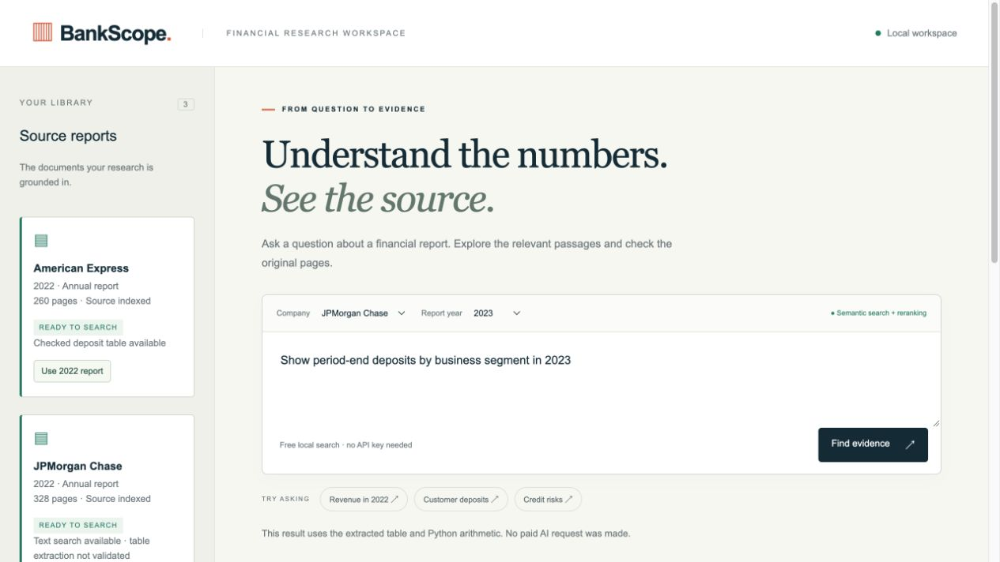
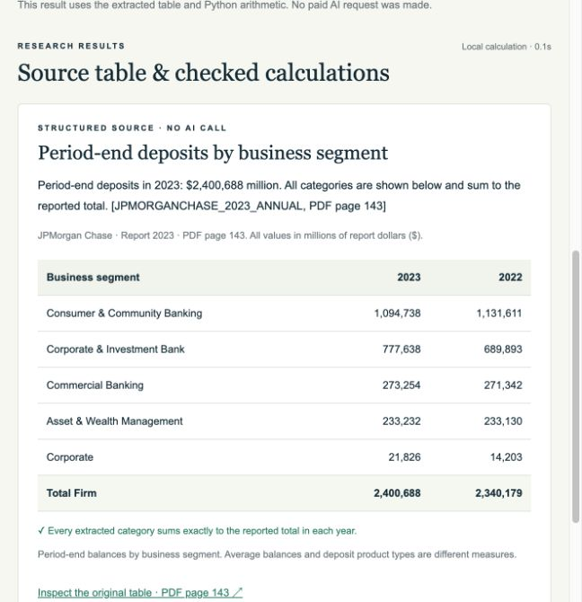
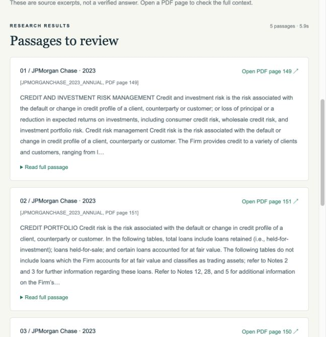
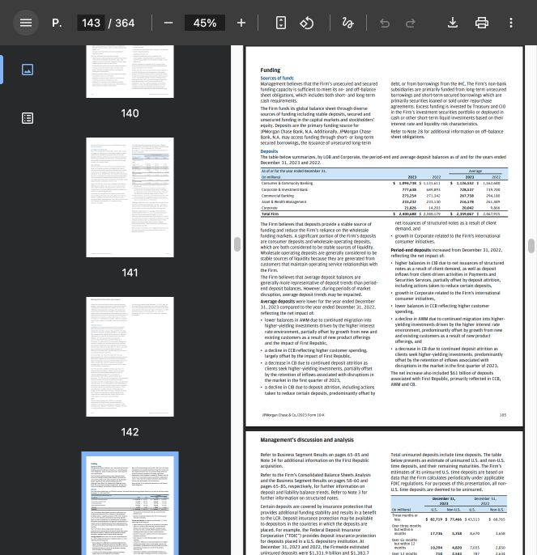
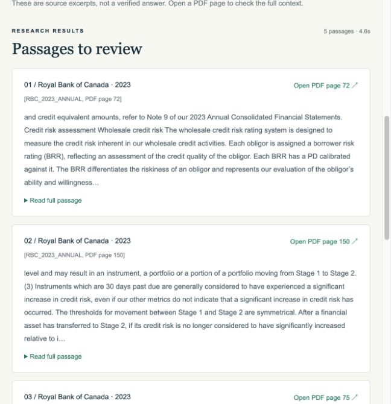
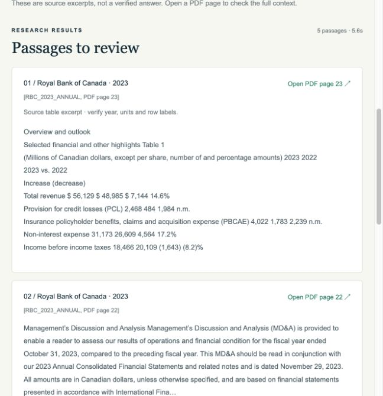

# BankScope — Banking Report Intelligence

A RAG research workspace for exploring bank annual reports, finding cited evidence,
and checking selected deposit tables with reproducible calculations.

**Python · FastAPI · BGE embeddings · MiniLM reranking · SQLite FTS5 · Docker**



[Watch the 60-second walkthrough](https://raw.githubusercontent.com/violetmn/bankscope/main/docs/media/bankscope-walkthrough.mp4)
— a silent, captioned sequence of real workspace screenshots.

<details>
<summary>See the workspace in action</summary>

**Checked deposit tables** — JPMorgan Chase, 2023; categories reconcile to the report total.



**Cited search results** — credit-risk passages with links to the original PDF pages.



**Original report** — inspect the cited table on PDF page 143.



**Canadian bank coverage** — cited passages from RBC’s 2023 annual report.



**Numerical evidence** — RBC credit losses with the source table’s years and units.



</details>

## Features

- **Cited research:** search by company and reporting year, then inspect the original PDF page.
- **Multi-stage retrieval:** BM25, dense search, hybrid fusion, and cross-encoder reranking.
- **Numerical evidence:** table-aware row retrieval with source headings, period columns, units and page citations.
- **Checked financial tables:** reconcile supported deposit categories and calculate changes with Decimal arithmetic.
- **Optional AI answers:** GPT-4o mini drafts with citation checks and a local request cap.
- **Reproducible evaluation:** retrieval metrics, per-query traces, corpus fingerprints, and recorded failures.

## Architecture

```text
Annual-report PDFs → Page extraction → Overlapping chunks → SQLite + BGE vectors
                                                               ↓
Question + company/year → Retrieve candidates → MiniLM reranker → Cited evidence
                                                               ↓
                                   Optional AI draft / checked table calculations
```

## Quick start

Python 3.11+:

```sh
git clone https://github.com/violetmn/bankscope.git
cd bankscope
python3 -m venv .venv
source .venv/bin/activate
pip install -e '.[dev,semantic]'

python scripts/fetch_financebench.py --company 'American Express' --max-docs 1
bankscope ingest data/financebench/pdfs/AMERICANEXPRESS_2022_10K.pdf \
  --id AMERICANEXPRESS_2022_10K --company 'American Express' --year 2022 \
  --url https://raw.githubusercontent.com/patronus-ai/financebench/main/pdfs/AMERICANEXPRESS_2022_10K.pdf
uvicorn bankscope.api:app --host 127.0.0.1 --port 8000
```

Open **http://127.0.0.1:8000/** for the workspace or **/docs** for the API.
This starts free keyword search. [Full setup](docs/SETUP.md) covers local models,
JPMorgan and Canadian bank reports, checked tables, and optional API configuration.

## Report coverage

The expanded local corpus contains **9 reports, 2,315 pages, and 7,687 passages**:
American Express (2022), plus JPMorgan Chase, RBC, TD, and BMO (2022-2023).
[Download and index the curated reports](docs/SETUP.md#add-jpmorgan-chase-and-canadian-bank-reports)
to reproduce the expansion. PDFs and vector indexes remain local.
The new table-aware route finds all 14 selected reference pages in a small numerical
development check, improving the original Canadian questions from 0/6 to 6/6.
[Results and limits](reports/validation/NUMERICAL_RETRIEVAL.md) are recorded; this
is retrieval evidence, not validated answer accuracy or checked calculations.

## Evaluation

**236 passing tests · approximately 86% combined statement/branch coverage** in the
latest local run. These measure software checks, not financial-answer accuracy.

Reference-page retrieval on a **12-question development pilot** across five reports:

| Method | Within a known report: Hit@5 | Across the corpus: Hit@5 |
| --- | --- | --- |
| BM25 | 2/12 | 2/12 |
| Standard reranker | 4/12 | 2/12 |
| Experimental focused retrieval | 8/12 | 8/12 |

The experimental method is slower and regressed on one earlier deposit question,
so it remains opt-in. These are inspected development results, not held-out accuracy.
A 20-call real-provider pilot is recorded; independent human answer scoring is pending.

[Evaluation summary and evidence](reports/README.md)

```sh
python -m pytest --cov=bankscope --cov-branch --cov-report=term-missing
```

## Project structure

```text
bankscope/    Ingestion, retrieval, generation, API, and web interface
tests/        Unit and integration tests
scripts/      Data preparation and benchmark utilities
datasets/     Public source manifests and diagnostic definitions
docs/         Setup, architecture, and evaluation
reports/      Evaluation summary, validation, and experiment records
```

## Scope and limitations

BankScope is a local research prototype. Checked-table support is limited to specific
layouts; other questions return source passages or optional unverified AI drafts.
Scanned PDFs need OCR, which is not implemented. There is no production authentication,
and the Docker configuration still needs deployment verification. API keys, downloaded
reports, model weights, and local answer data are excluded from Git.

## Documentation and data

- [Setup and usage](docs/SETUP.md) · [Architecture](docs/ARCHITECTURE.md)
- [FinanceBench](https://github.com/patronus-ai/financebench): public financial QA annotations and report sources.
- [FinRAG-QA](https://github.com/Lsilotto/FinRAG-QA): larger banking benchmark preparation; source mapping and independent review remain in progress.

Third-party reports and annotations retain their upstream terms. Downloads stay local.
