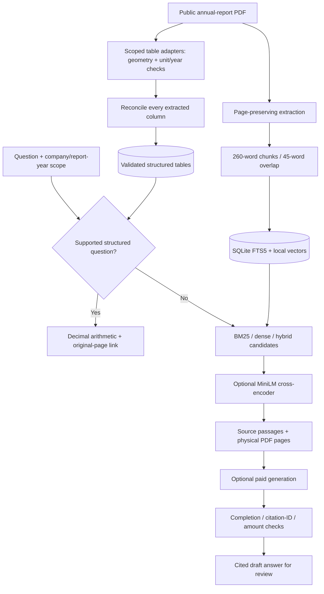

# BankScope architecture

BankScope helps an analyst locate evidence in bank annual reports and inspect
specific deposit tables. It uses public historical company reports, not customers'
transaction histories, and does not provide personalized financial advice.

## Why these choices

- **SQLite:** one inspectable local database with lexical search and reproducible
  vector storage; appropriate for this small corpus. Dense scoring loads vectors
  in memory. Larger corpora would need measured indexing/scaling work.
- **Local models:** BGE embeddings and MiniLM reranking avoid per-query provider
  fees. Model weights download during explicit preparation, not query execution.
- **Two retrieval stages:** candidate recall and cross-encoder precision are tested
  separately. Reranking is not guaranteed to outperform lexical retrieval.
- **Page boundaries:** evidence links lead back to a physical PDF page. A passage
  can still omit a needed heading or split a table; page retrieval is not proof.
- **Structured arithmetic:** checked deposit workflows calculate from extracted
  cells. Generated prose does not inherit the same reconciliation guarantees.
- **Separate labels:** benchmark answers/evidence are never added to retrieval
  context. Report-year filtering does not identify every comparative value year.

## Trust boundaries

PDF text is untrusted source material. Provider output is a draft. Citation-ID
validation prevents references to unknown supplied IDs but does not establish
entailment. Numeric checks do not establish correct row/year alignment. There is
no empirical prompt-injection resistance claim or real-provider accuracy score.

Ingestion is CLI-only. The API serves registered reports from fixed local roots.
Secrets stay in the server environment. Generated-answer attempts are explicitly
enabled and capped locally; the cap is not an account-wide dollar budget.

The application currently runs locally without production authentication. Public
hosting requires access control, rate limits, provider-budget controls, secure
secret storage and deployment verification.
